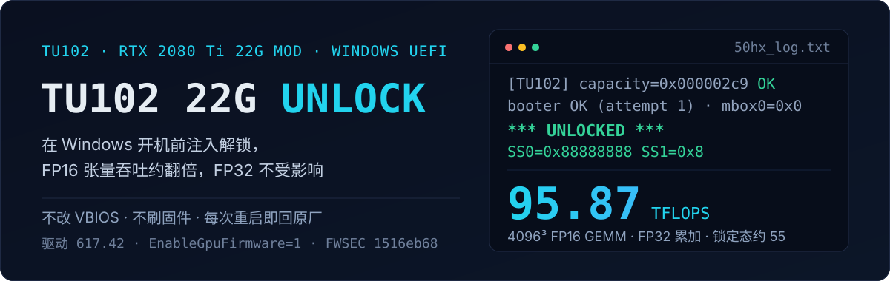

<p align="center">
  
</p>

# TU102 22G 张量解锁实录（Windows / UEFI）

**在 Windows 开机之前，把 TU102 的 FP16→FP32 累加张量半速限制打开。** 实测 4096³ FP16 GEMM **95.87 TFLOPS**（锁定态上界约 54），FP32 对照不变；不改 VBIOS、不刷固件、不做任何持久化——**断电即回原厂**。

`10de:1e07` · VBIOS `90.02.0b` · Intel B760 · Windows 11 · 驱动 `617.42` · 易失解锁

> ⚠️ **本仓库不包含任何 NVIDIA 固件，也不分发可执行镜像。** 四个固件 blob 由上游脚本按 SHA-256 拉取并校验，FWSEC 必须从**你自己的卡**转储提取。没有你的卡自己的固件，这套东西一步都走不了——这是设计，不是限制。

---

## 结果速览

### 身份与判据

| 项目 | 值 |
|---|---|
| GPU | RTX 2080 Ti 22 GiB 改装卡（TU102，68 SM，报 21.7 GiB） |
| PCI ID | `10de:1e07`，子系统 `10de:12a4` |
| VBIOS | `90.02.0b` |
| 平台 | JGINYUE B760M + i5-12400F（Intel，UEFI） |
| 系统 / 驱动 | Windows 11 Pro Insider / `617.42` |
| 原生 FWSEC | sha256 `1516eb68…`，39440 B（从本机 PROM 转储提取） |
| 解锁判据 | `SS0=0x88888888`、`SS1=0x8`（锁定态为 `SS0=0x00002001`、`SS1=0x00000006`） |
| 引导交棒 | 从 U 盘链式加载 `bootmgfw.efi`，无重 POST；`EnableGpuFirmware=1` 下驱动接受 pre-OS 状态 |

### 吞吐（本机解锁态实测，`bench/bench_gemm.py` 中位数）

| 工作负载 | 解锁态 | 说明 |
|---|---:|---|
| FP16 GEMM 2048³（FP32 累加） | **79.97 TFLOPS** | 小尺寸受启动开销影响 |
| FP16 GEMM 3072³ | **75.27 TFLOPS** | |
| FP16 GEMM 4096³ | **95.87 TFLOPS** | 尺寸最大，最接近峰值（短时中位数，非持续值） |
| FP32 GEMM 2048³（对照） | **13.40 TFLOPS** | 与解锁无关，用于证明不是超频 |

`torch 2.11.0+cu128` / CUDA 12.8。物理参照：2080 Ti 的 FP16 张量峰值约 107.6 TFLOPS（FP16 累加），锁定态只允许 FP32 累加半速 ≈ **53.8 TFLOPS**；解除后同一条 GEMM 路径达到 95.87，约峰值的 89%。

> **诚实说明**：上表只有解锁态实测。同一台机器上做锁定态 A/B 需要再冷启动一次（不插 U 盘），本仓没有做——因此"提升倍数"在本仓只以上述物理上界推算，不冒充实测。上游同型卡在 4096³ 的公开数据是锁定 49.9~53.7 → 解锁 80.3~81.3 TFLOPS，**但那台机器用 200 次预热 + 100 次计时的持续跑法**，本仓是 10 + 30 次，两组数值不可横向比较，只能作形态参考（详见 [docs/04-benchmark.md](docs/04-benchmark.md)）。

---

## 一句话原理

2080 Ti 的 Tensor Core 在「FP16 输入 + FP32 累加」这条路径上被固件刻意限速一半。这个限制最终落在两个寄存器位上：

```
SS0  (0x409664) = 0x88888888
SS1  (0x40966c) = 0x00000008
```

写入它们的不是驱动，也不是 VBIOS，而是**在 UEFI 阶段运行的一小段 EFI 程序**：它用 SEC2 Falcon + FECS ROP 打开 PLM 保护，再写这两个寄存器，然后把控制权交回 Windows 启动管理器。因为发生在任何驱动加载之前，Windows 拿到的就是一张"天生解锁"的卡；因为只是寄存器，**任何重启 / 断电都会回到原厂状态**。

Windows 侧唯一的开关是注册表 `EnableGpuFirmware=1`（走 GSP-RM 路径）。没有它，驱动会拒绝这张"状态异常"的卡，设备管理器直接 Code 43。

---

## 为什么走这条路

| 方案 | 能到 Windows 吗 | 持久性 | 代价 / 风险 |
|---|---|---|---|
| VIX 编辑器（改电压/频率曲线） | 是 | 写入 VBIOS | **这是超频，不是解除半速**，与本目标无关 |
| 直接改 VBIOS | 是 | 持久 | 需过签名校验，改错变砖，无回滚 |
| KohakUnlock（Linux） | 否 | 每次启动重做 | 需要 Linux + 驱动侧配合 |
| **本方案：pre-OS EFI 注入** | **是** | **易失** | **不做任何持久化写；风险集中在"Secure Boot 必须关"这一条** |

关键取舍：**易失性本身就是安全阀**。刷坏 VBIOS 是不可逆的；而这条路线最坏的结果是"这次开机没解锁成功"，重启即恢复。唯一的持久化痕迹是注册表里一个 DWORD 和一个 U 盘上的 EFI 文件。

---

## 五步流程

<p align="center">
  
</p>

| 阶段 | 做什么 | 是否写卡 | 产物 |
|---|---|---|---|
| 01 只读转储 | 一个**零固件依赖**的 `TU102DUMP.EFI` 从 U 盘引导，读 1 MiB PROM 窗口写回 U 盘 | 否 | `tu102_prom_300000.bin`（`55aa` 头 + 有效 ROM） |
| 02 FWSEC 标定 | 从 PROM 里解析 FECS 的 ROM 描述符，提取 FWSEC blob 与其 DMEM 几何 | 否 | 10 个常量 + FWSEC 哈希 |
| 03 构建 EFI | 把 4 个固件 blob + 你的 FWSEC 嵌进 `unlock50x_v1.c` 的移植版并编译 | 否 | `TU102UNLK.EFI`（本机 sha256 `717a9467…`） |
| 04 解锁引导 | U 盘引导 → 写 SS0/SS1 → 链载 `bootmgfw.efi` → Windows 起来 | 只写 GPU 寄存器 | `50hx_log.txt` 里的 `*** UNLOCKED ***` |
| 05 基准验证 | FP16 GEMM（FP32 累加）+ FP32 对照 | 否 | `results.json` |

**01–03 全程只读，04 只在插着 U 盘引导的那一次开机内生效，任何重启都回原厂。**

---

## 这套配置真正新增了什么

上游（`chenxluo/tu102-22g-uefi-unlock`）和它的上游（`xrip/cmp50hx-unlock`）已经把机制打通，但那是在**别人家的卡**上。这个仓库记录的是换一张卡之后必须重做的两件事：

### 1. 新固件家族 = 必须重新标定，不能照抄常量

本机的 FWSEC 是 `1516eb68…`（39440 B）——和上游 22G 参照卡的 `c6fa28fa…` **不是同一个 blob**，因此所有 DMEM 几何偏移都不能沿用：

| 常量 | 上游 22G 参照卡 | **本机（90.02.0b）** |
|---|---:|---:|
| `FW50_CODE_SIZE` / `FW50_DATA_OFF` | `0x9800` | **`0x9600`** |
| `FW50_DMEM_SIZE` | `0x420` | **`0x410`** |
| `FW50_BLOB_SIZE` | `0x9C20`（39968 B） | **`0x9A10`（39440 B）** |
| `FW50_IFACE_OFF` | `0xE0` | **`0xDC`** |
| `FW50_MAPPER_OFF` | `0x390` | **`0x380`** |
| `FW50_CMDIN_OFF` | `0x3E0` | **`0x3D0`** |
| `FW50_SEC_BASE` / `FW50_SEC_SIZE` | — | **`0x300` / `0x9300`** |

而这两个家族之间有三条**可复用的不变量**，标定完成后可以拿来抓抄错行：

| 不变量 | 本机 | 上游参照 |
|---|---|---|
| `BLOB_SIZE = CODE_SIZE + DMEM_SIZE` | `0x9A10 = 0x9600 + 0x410` | `0x9C20 = 0x9800 + 0x420` |
| `SEC_BASE + SEC_SIZE = CODE_SIZE` | `0x300 + 0x9300 = 0x9600` | `0x400 + 0x9400 = 0x9800` |
| `CMDIN_OFF − MAPPER_OFF = 0x50` | `0x3D0 − 0x380` | `0x3E0 − 0x390` |

完整的解析方法、字节级三重闭合校验写在 **[docs/02-fwsec-calibration.md](docs/02-fwsec-calibration.md)**——这是本仓最值得复用的部分，换任何一张 TU102 卡都要走一遍。

### 2. Intel 平台首证

上游与已知成功案例都在 AMD 平台（B350 / X99）。本机是 **Intel B760 + i5-12400F**：BIOS 里只需「Above 4G Decoding 开 / Secure Boot 关」，没有 Fast Boot 项也不影响——这条路线在 Intel 消费者主板上同样成立。

### 3. 驱动侧换了一代

本机是 **617.42 + Windows 11 Pro Insider**（上游验证的是 621.01），`EnableGpuFirmware=1` 之后驱动正常接受 pre-OS 状态，无 Code 43、无新增 Xid、22 GiB 显存完整。

---

## 快速开始

> 完整逐步操作（含每一步的真实输出与截图位）见 **[docs/01-walkthrough.md](docs/01-walkthrough.md)**。这里只给骨架。

### 前置

- 一张 TU102 系 22 GiB 改装卡（11 GiB 卡会在容量守卫处被直接拒绝，见下）
- 一台能构建 `gnu-efi` 的 Linux——本机用 **WSL2 Ubuntu 24.04**（`apt install build-essential gnu-efi`）
- BIOS：**Above 4G Decoding = Enabled，Secure Boot = Disabled**
- 一个会被完全格式化的 U 盘（≥1 GB）

### 阶段 0 · 只读转储（不需要任何固件）

```bash
# WSL / Linux，在移植仓库的 efi-unlock-tu102/ 下
DUMP_ONLY=1 ./build.sh          # => TU102DUMP.EFI（零固件依赖，DUMP_ONLY 分支用占位符顶掉链接）
```

```powershell
# Windows 管理员 PowerShell（本仓提供的纯 ASCII 脚本，PS 5.1 可直接跑）
.\tools\make-usb-ascii.ps1 -DriveLetter G -Image .\efi-unlock-tu102\TU102DUMP.EFI
```

U 盘引导后，屏幕上会依次出现里程碑与暂停提示；日志与两个 1 MiB PROM 窗口会被写回 U 盘：

```
[TU102 f] fast hit enc=2 01:00.0 id=0x1e0710de
[TU102] capacity=0x000002c9 OK (22GiB identity confirmed)
[dump] \tu102_prom_300000.bin head=55aa76eb (55aa=PCI-ROM ok)
```

> `capacity=0x2c9` 是本仓与上游都保留的**身份守卫**：它只在 22 GiB 布局成立。11 GiB 卡读到别的值，程序在写任何东西之前就退出。

### 阶段 1 · FWSEC 标定

从 `tu102_prom_300000.bin` 解析 ROM 描述符，得到 FWSEC blob 与几何常量，然后改写 `unlock50x_v1.c` 的两处：

```c
#define U40X_TARGET_DID         0x1E07u   /* 本机 10de:1e07（原 1E04/1E09） */
#define FW50_CODE_SIZE          0x00009600UL
#define FW50_DATA_OFF           0x00009600UL
#define FW50_DMEM_SIZE          0x00000410UL
#define FW50_BLOB_SIZE          0x00009A10UL
#define FW50_IFACE_OFF          0x000000DCUL
#define FW50_MAPPER_OFF         0x00000380UL
#define FW50_CMDIN_OFF          0x000003D0UL
#define FW50_NS_SIZE            0x00000300UL
#define FW50_SEC_BASE           0x00000300UL
#define FW50_SEC_SIZE           0x00009300UL
```

本仓提供成品补丁：**[patches/tu102-1e07-0b-family.patch](patches/tu102-1e07-0b-family.patch)**（只含设备 ID 与上述常量，**不含任何固件字节**）。

### 阶段 2 · 构建并引导

```bash
./tools/get-blobs.sh            # 从上游固定提交取 4 个 TU102 blob
# 把你自己的 FWSEC 放到 blobs/fwsec_native.bin
TU102_ALLOW_FWSEC=1 ./build.sh  # 非参照卡哈希时必须显式 opt-in
# => TU102UNLK.EFI
```

```powershell
.\tools\make-usb-ascii.ps1 -DriveLetter G -Image .\efi-unlock-tu102\TU102UNLK.EFI
.\tools\gsp-mode-ascii.ps1 on   # EnableGpuFirmware=1（仅目标 GPU 实例）
# 重启，BIOS 选 U 盘引导
```

成功的标志只有一行：

```
[50HX] *** UNLOCKED (SS0=0x88888888 SS1=0x8) ***
```

`PLM=0xffffff8f`、`[rebar] no 16 GiB-aligned span — skip`、`WARN dst!=0xfd00` 之类的输出**都是正常的**，不是错误——判据只有 SS0/SS1。完整清单见 [docs/03-pitfalls.md](docs/03-pitfalls.md#15-检验清单出问题时按这个顺序看)。

### 日常使用

| 想做什么 | 动作 |
|---|---|
| 这次开机会用到解锁算力 | 插 U 盘 → 开机选 U 盘引导 → Windows 起来后 U 盘可以拔 |
| 这次开机不需要 | 正常开机（不插 U 盘）→ 出厂性能 |
| 想彻底回到原厂 | `gsp-mode-ascii.ps1 off` 删掉注册表项即可 |

**任何重启都会回到锁定态**，包括 Windows 更新自动重启——不会坏，只是这次白跑。

---

## 边界与未验证项

**已验证**：单卡单机、Intel B760、Windows 11 Insider、驱动 617.42、U 盘引导路径、`EnableGpuFirmware=1` 下无 Code 43、22 GiB 显存完整可见、`nvidia-smi` 正常识别。

**未验证**：
- **数值精度**：本仓基准脚本不含误差校验（`bench/bench_gemm.py` 只测吞吐）。上游在**另一张卡**上测得最大相对误差 `2.5e-4`，本机未复现；自测方法见 [docs/04-benchmark.md](docs/04-benchmark.md#53-精度本仓没测)
- **锁定态 A/B**：同一台机器上的锁定态对照需要不插 U 盘冷启动一次再跑同一脚本，本仓未做（见下）
- 长时间烤机（小时级）稳定性；本仓只跑到基准脚本的量级
- 多卡 / 其它 22 GiB 卡个体 / 其它 VBIOS 家族（每换一个 FWSEC 家族都要重走阶段 1）
- 11 GiB 卡（会被容量守卫拒绝，未做任何适配）
- 驱动大版本升级后的 GSP 接受行为（机制上与驱动版本无关，但只实测过 617.42）

**已知风险**：
- Secure Boot 必须关闭——这是 pre-OS 执行未签名代码的前提，不是本仓能绕过的
- 解锁发生在 UEFI 阶段，卡在这段时间内处于非出厂状态；如果你启用了 BitLocker，启动顺序的改变可能触发恢复提示——本机没有启用，因此这条**未经验证**，请先确认恢复密钥在手（见 `docs/03-pitfalls.md`）
- 本机 BIOS 的 PCIe 重定 BAR 分配窗口不足 16 GiB，`[rebar] no 16 GiB-aligned span` 属正常跳过，不影响解锁

---

## 固件红线（请先读这段再 fork）

**绝不提交、绝不分发**：`blobs/*.bin`、`*.EFI`、PROM 转储（`tu102_prom_*.bin`）、VBIOS、FWSEC 二进制。

本仓 `.gitignore` 已把这些路径全部挡住。要复现的人必须：

1. 用 `tools/get-blobs.sh` 从上游**按 SHA-256 校验**拉取公共 blob；
2. 用**自己的卡**跑阶段 0 转储，提取自己的 FWSEC；
3. 自己构建。构建产物同样不可分发（里面嵌着 NVIDIA 固件）。

四个公共 blob 的期望哈希（与上游 `build.sh` 的 pins 一致）：

```
v67_payload.bin        de7288bcfb80c2d4b259a59e823c926ba0a9adcab594219cc6802c94257ce271
booter_ucode_prod.bin  e0f0fc93da097b5b68e5af3adb58b2235ed1fad5fce0b23592d3895af44cb743
gsp_rm_boot_dbg.bin    fa43239bcee7b97ca62f007cc68487560a39e19f74f3dde7486db3f98df8e471
bl_gsp_tu102.bin       f21f1cfbb8fffa8067685314367fc4c50f3f84dd99eda7c19db4292d9269b9d9
```

本机原生 FWSEC（仅供你校验"我的是不是同一家族"，**不是可下载的固件**）：

```
fwsec_native.bin       1516eb686e3b4a379f9c5739720b4ebf938700c2b5bf65686006ccd3999e2227
```

---

## 目录结构

```
.
├─ README.md                       本篇
├─ LICENSE                         MIT（仅覆盖文字/脚本/补缺，不含固件权利）
├─ docs/
│  ├─ 01-walkthrough.md            逐步复现：从 BIOS 设置到第一行 UNLOCKED
│  ├─ 02-fwsec-calibration.md      FWSEC 标定方法论（换卡必读）
│  ├─ 03-pitfalls.md               15 个坑与排查清单
│  └─ 04-benchmark.md              基准方法、原始数据、结论边界
├─ patches/
│  └─ tu102-1e07-0b-family.patch   设备 ID + 10 个几何常量（无固件字节）
├─ tools/
│  ├─ make-usb-ascii.ps1           做 U 盘（纯 ASCII，PS 5.1 可跑）
│  ├─ gsp-mode-ascii.ps1           EnableGpuFirmware on/off/status
│  └─ get-blobs.sh                 按 SHA-256 拉取 4 个公共 blob
├─ bench/
│  ├─ bench_gemm.py                FP16 GEMM + FP32 对照
│  └─ results-2080ti-22g-1e07.json 本机原始结果
└─ assets/readme/                  README 用的两个 SVG（纯矢量，无外部依赖）
```

---

## 许可与致谢

本仓的**文字、脚本与补丁**以 MIT 发布（见 [LICENSE](LICENSE)）。**不包含任何 NVIDIA 固件或可执行镜像。**

机制与代码的来源链：

- `PZH1gdmu/CMP40HX-Unlock`（MIT）—— 原始利用链
- `xrip/cmp50hx-unlock`（MIT，固定提交 `df2fe11`）—— TU102 GSP 化移植
- `chenxluo/tu102-22g-uefi-unlock`（MIT）—— 22 GiB / Windows / GSP 路线的完整落地，本仓是它在**另一张卡**上的移植记录
- `KohakuBlueleaf/KohakUnlock`（GPL-2.0）—— 仅参考其**公开文档**中的实测常量与现象，未复制代码

NVIDIA、GeForce、RTX 是 NVIDIA Corporation 的商标。本项目与 NVIDIA 无任何关联，属非官方研究记录；用于你自己的硬件，风险自担。
